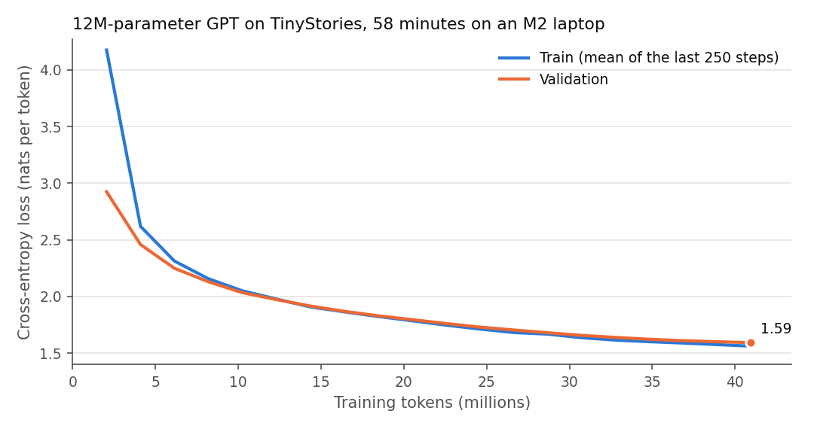
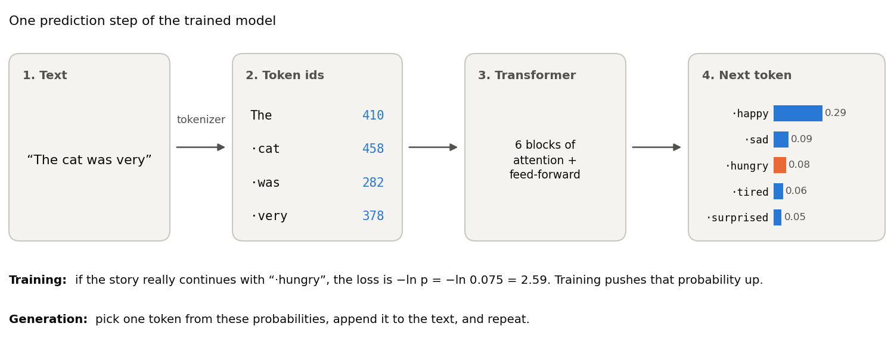
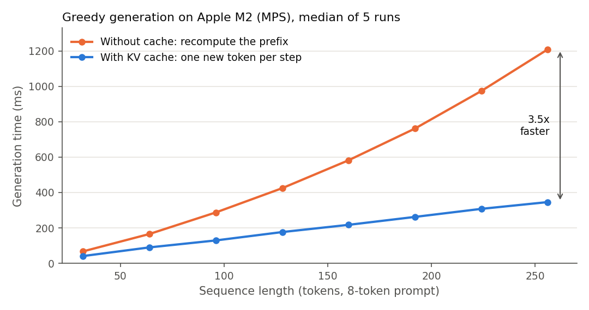

# Language Model Pre-training

[](https://github.com/mstftmk/language-model-pretraining/actions/workflows/tests.yml)

A small GPT-style language model, **pre-trained from scratch** on the [TinyStories](https://arxiv.org/abs/2305.07759) dataset. Every part is written here in plain PyTorch and Python: a byte-level BPE tokenizer, a decoder-only transformer with RoPE, RMSNorm and SwiGLU, the training loop, and a KV cache for fast generation. It trains in under an hour on an 8 GB Apple M2 laptop.

**Result:** a 12.2M-parameter model reached a validation loss of **1.575 nats per token** (perplexity 4.83, **0.570 bits per byte**) after 41M training tokens and **58 minutes** of training. It writes short stories with correct grammar and a clear plot, though its logic still slips at times.



*Loss per token while training. A model that guesses uniformly over the 4,096 tokens would score ln 4096 = 8.32. Train and validation stay close, so the model is not memorising the training text, and both are still falling at the end: a longer run would do better.*

A story it wrote, from the prompt **"Once upon a time"** (temperature 0.8, top-k 50, unedited):

> Once upon a time, there was a brave girl named Lucy. She had a little house in her garden. In her house, there was a big box with a bow on it. Lucy loved her bow very much.
> One day, Lucy's mom told her that if she had a toy, it might be available. Lucy was very excited and thought it might help her. She asked the box to be the one at the top of the box. But the box was too heavy and she just couldn't move the bow.
> Lucy was sad, but she tried again and again. Finally, she got the bow from the box and held it tight. She said goodbye to the box and the box. Lucy was safe and happy because she had her bow. She knew that her mom would always make her feel safe and happy.

The story has a beginning, a problem, a second try and an ending, but some sentences do not make sense ("it might be available", "goodbye to the box and the box"). More samples are in [`results/base-5000/samples.txt`](results/base-5000/samples.txt).

| | |
|---|---|
| Model | 6 layers, width 384, 6 heads, context 256 tokens, 12.19M parameters |
| Tokenizer | Byte-level BPE, 4,096 tokens, 3.99 bytes per token on validation text |
| Training data | First 400 MB of the 2.2 GB TinyStories V2 training file (105M tokens) |
| Tokens seen | 41M (5,000 steps of 8,192 tokens), about 0.39 passes over that data |
| Hardware and time | Apple M2, 8 GB, PyTorch MPS, float32: 57.8 minutes, about 11,800 tokens per second |
| Validation | The full TinyStories V2 validation file, 5.6M tokens, every token scored once |

## What pre-training means



*A real prediction from the trained model. `scripts/make_pipeline_diagram.py` draws it from the checkpoint.*

**The task is next-token prediction.** A language model takes the text so far and gives a probability to every token in its vocabulary for coming next. Pre-training shows it a large amount of real text and, at every position, asks for the token that comes next. No labels are needed, because the text is its own answer key. This is why it is called self-supervised, and why it can use any amount of raw text. One pass over a 256-token window makes 256 predictions at once, and the causal mask makes sure each one sees only the tokens before it.

**Loss and perplexity.** The loss at one position is minus the log of the probability the model gave to the true next token, as in the figure. Averaged over all positions, 0 would mean certainty, and 8.32 is a uniform guess over 4,096 tokens. Perplexity is e to the power of the loss: the final 4.83 means the model is, on average, about as unsure as if it were choosing evenly among 5 tokens. Both numbers depend on the tokenizer, so to compare with other models, use bits per byte (0.570 here) on the same validation text.

**Generation.** To write text, the model picks one token from these probabilities, appends it and predicts again. *Temperature* divides the scores before they become probabilities: below 1 favours likely tokens (safer, more repetitive), above 1 flattens them (more varied, more mistakes). *Top-k* keeps only the k most likely tokens. The samples here use temperature 0.8 and top-k 50.

**Where this fits.** Chat assistants are built in stages: pre-training on large amounts of text, then fine-tuning on example instructions and answers, then tuning on human preferences ([Ouyang et al., 2022](https://arxiv.org/abs/2203.02155)). This repository does only the first stage, at small scale. The model continues text; it does not follow instructions.

## Contents

| Path | What it is |
|---|---|
| [`src/tinylm/tokenizer.py`](src/tinylm/tokenizer.py) | Byte-level BPE: training, encoding, decoding, special tokens, save and load |
| [`src/tinylm/model.py`](src/tinylm/model.py) | The transformer, RoPE, RMSNorm, SwiGLU, KV cache and sampling |
| [`src/tinylm/data.py`](src/tinylm/data.py) | Reading text in story-aligned chunks and sampling training windows |
| [`scripts/`](scripts) | Train the tokenizer, encode the data, train, evaluate, sample, benchmark, draw the figures |
| [`assets/tokenizer_tinystories_4096.json`](assets/tokenizer_tinystories_4096.json) | The trained tokenizer (47 KB of merge rules, no text) |
| [`results/`](results) | Training log, full-validation scores, samples and KV cache timings |
| [`tests/`](tests) | 37 tests, run by GitHub Actions on Python 3.10 to 3.12 |

## How it works

### 1. Tokenizer: byte-pair encoding

A language model reads integers, so text first becomes a list of token ids. This tokenizer starts from the 256 possible byte values, so any text, in any language, can be encoded without an "unknown" token. Training then repeats one step: find the pair of neighbouring tokens that occurs most often in the corpus and merge it into a new token. After 3,839 merges the vocabulary has 4,096 entries: 256 bytes, 3,839 merges and the special token `<|endoftext|>` that separates stories.

The first merges it learned were `" t"`, `"he"`, `" a"`, `" s"`, `" w"`, `"nd"` and `" the"`. Text is split into words with their leading space before merging (the GPT-2 pattern), so a merge never joins the end of one word to the start of the next.

| Text | Bytes | Tokens | Split |
|---|---:|---:|---|
| `Once upon a time, Lily found a shiny red ball.` | 46 | 12 | `Once` `·upon` `·a` `·time` `,` `·Lily` `·found` `·a` `·shiny` `·red` `·ball` `.` |
| `The dinosaur was unhappy.` | 25 | 7 | `The` `·dinosaur` `·was` `·un` `h` `appy` `.` |
| `Merhaba dünya` (Turkish) | 14 | 10 | Mostly short pieces, and `ü` falls back to its 2 raw bytes |

*`·` marks a space. Common words in the stories are single tokens. Rare words and other languages still work, they just take more tokens.*

The slow part of training is counting, so the trainer counts each distinct word once (17,124 distinct words in 50 MB of text) and updates pair counts only for words that contain the merged pair. It learns all 3,839 merges in 0.3 s. A test checks that it learns exactly the same merges as a simple version that recounts everything after each merge.

### 2. The transformer

The model is a stack of 6 identical blocks. Each block lets every token gather information from the tokens before it (attention), then transforms each token on its own (the feed-forward layer). The output is a score for every token in the vocabulary, and training lowers the cross-entropy between those scores and the token that actually came next.

| Part | What it does here | Why |
|---|---|---|
| Causal attention | Each position attends only to itself and earlier positions | The model must predict the next token without seeing it. A test changes future tokens and checks that earlier outputs do not move. |
| RoPE (rotary position embedding) | Rotates query and key vectors by an angle that grows with position | The attention score then depends on the distance between two tokens, not their absolute positions. A test checks this directly. |
| RMSNorm | Scales each vector to unit root-mean-square before attention and before the feed-forward layer | Simpler than LayerNorm (no mean, no bias) and keeps training stable. |
| SwiGLU feed-forward | `W2(silu(W1 x) * W3 x)`, hidden size 1,024 | A gated feed-forward layer, with three matrices sized to match the usual two-matrix layer in parameters. |
| Tied embeddings | The input embedding matrix is reused as the output layer | Saves 1.6M parameters; untied, they would add 13% to this model. |

### 3. KV cache

To generate text, the model predicts one token, appends it and predicts again. Without a cache, every step reprocesses the whole sequence, so the cost of a step grows with its length and the total grows with the square of the length. The keys and values of earlier tokens never change, though, so the KV cache stores them and each step processes only the newest token.



*With the cache, generating 256 tokens takes 0.35 s instead of 1.21 s. The gap widens with length. Both versions produce exactly the same tokens; the benchmark script checks this on every run, and a test checks that the cached logits match a full forward pass.*

## Training setup

| Setting | Value |
|---|---|
| Optimiser | AdamW, betas (0.9, 0.95), weight decay 0.1 on weight matrices only |
| Learning rate | Linear warm-up for 200 steps to 1e-3, then cosine decay to 1e-4 |
| Batch | 16 sequences of 256 tokens, gradients accumulated over 2 batches (8,192 tokens per step) |
| Gradient clipping | Norm 1.0 |
| Initialisation | Normal, std 0.02; residual output layers scaled by 1/sqrt(2 × layers) |
| Logged validation | Every 250 steps, on the same 81,920 validation tokens each time (the final score above uses the whole validation file) |

The batch is split in two because a batch of 32 used 3.5 GB of memory on the 8 GB laptop, while 16 used 2.3 GB and ran at the same speed.

## Tests

```bash
pip install -e ".[dev]"
pytest
```

The 37 tests check, among other things, that:

- the tokenizer decodes back to the exact input, including Turkish letters, emoji and random Unicode;
- the fast BPE trainer learns the same merges as a simple reference version, and the encoder matches applying the merges one by one;
- future tokens cannot change earlier outputs (the causal mask);
- generation with the KV cache gives the same tokens and logits as recomputing everything;
- the RoPE score depends only on relative position, and RoPE keeps vector lengths;
- a tiny model can memorise a small batch, which shows that the loss, gradients and optimiser are wired correctly.

## Reproduce

```bash
pip install -e ".[dev]"
pip install matplotlib   # only for the figures

# 1. Data: TinyStories V2 from Hugging Face (roneneldan/TinyStories), into data/
#    TinyStoriesV2-GPT4-valid.txt (22.5 MB) and TinyStoriesV2-GPT4-train.txt (2.2 GB)

# 2. Tokenizer (about 2 s; the trained one is already in assets/)
python scripts/train_tokenizer.py --input data/TinyStoriesV2-GPT4-train.txt \
    --max-mb 50 --vocab-size 4096 --out assets/tokenizer_tinystories_4096.json

# 3. Encode the text into token files
python scripts/prepare_data.py --tokenizer assets/tokenizer_tinystories_4096.json \
    --input data/TinyStoriesV2-GPT4-valid.txt --out data/valid.bin
python scripts/prepare_data.py --tokenizer assets/tokenizer_tinystories_4096.json \
    --input data/TinyStoriesV2-GPT4-train.txt --max-mb 419.4304 --out data/train.bin  # first 400 MiB

# 4. Train (about an hour on an M2; uses CUDA or MPS when available)
python scripts/train.py --train data/train.bin --valid data/valid.bin \
    --tokenizer assets/tokenizer_tinystories_4096.json --out runs/base --max-steps 5000

# 5. Evaluate, sample, benchmark, plot
python scripts/evaluate.py --ckpt runs/base/ckpt.pt --tokens data/valid.bin \
    --text data/TinyStoriesV2-GPT4-valid.txt
python scripts/sample.py --ckpt runs/base/ckpt.pt \
    --tokenizer assets/tokenizer_tinystories_4096.json --prompt "Once upon a time"
python scripts/benchmark_kv_cache.py --ckpt runs/base/ckpt.pt --out results/kv_cache.csv
python scripts/plot_results.py
python scripts/make_pipeline_diagram.py --ckpt runs/base/ckpt.pt \
    --tokenizer assets/tokenizer_tinystories_4096.json
```

The model checkpoint (49 MB) is not in the repository.

## Notes

This is a single run with one seed, so I would not read much into the second decimal of the loss. The run was also short: the model saw 41M tokens, and the loss was still going down when it stopped, so a longer run should do better. TinyStories is a narrow dataset of simple children's stories written by GPT-4, so the model knows very little outside that world and can only continue text. The speeds are from my own M2 laptop in float32 and will be different on other hardware.

## References

- R. Eldan and Y. Li, [TinyStories: How Small Can Language Models Be and Still Speak Coherent English?](https://arxiv.org/abs/2305.07759), 2023. Dataset: [roneneldan/TinyStories](https://huggingface.co/datasets/roneneldan/TinyStories), CDLA-Sharing-1.0.
- R. Sennrich, B. Haddow and A. Birch, [Neural Machine Translation of Rare Words with Subword Units](https://arxiv.org/abs/1508.07909), 2016 (BPE).
- A. Radford et al., [Language Models are Unsupervised Multitask Learners](https://cdn.openai.com/better-language-models/language_models_are_unsupervised_multitask_learners.pdf), 2019 (GPT-2, byte-level BPE).
- J. Su et al., [RoFormer: Enhanced Transformer with Rotary Position Embedding](https://arxiv.org/abs/2104.09864), 2021.
- B. Zhang and R. Sennrich, [Root Mean Square Layer Normalization](https://arxiv.org/abs/1910.07467), 2019.
- N. Shazeer, [GLU Variants Improve Transformer](https://arxiv.org/abs/2002.05202), 2020.
- L. Ouyang et al., [Training language models to follow instructions with human feedback](https://arxiv.org/abs/2203.02155), 2022 (InstructGPT).
- O. Press and L. Wolf, [Using the Output Embedding to Improve Language Models](https://arxiv.org/abs/1608.05859), 2017.

## License

MIT for the code. The TinyStories data is not included; it is licensed under CDLA-Sharing-1.0.
